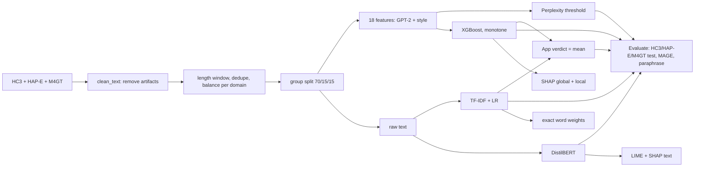

# GlassQuill: Explainable Detection of AI-Generated Text

Technical report. Code: [github.com/ThatOneRahul/glassquill](https://github.com/ThatOneRahul/glassquill)

---

## Abstract

Large language models now write text that people cannot reliably tell apart from human writing, and the detectors used by colleges give a score with no reason. A wrong flag can hurt a student, and non-native writers are flagged more often. GlassQuill labels an English text (50-400 words) as human-written or AI-generated and explains every decision. We train four models that range from transparent to black box: a GPT-2 perplexity threshold, TF-IDF with logistic regression, XGBoost on 18 style and perplexity features, and fine-tuned DistilBERT. The training data covers 2022 ChatGPT (HC3) and recent models such as GPT-4o, Llama-3, Mixtral and Gemma (HAP-E and M4GT): 32,000 texts, balanced by class in each of 17 domains and split by question or document so that no topic leaks. The app's verdict, the mean of the two explainable models, reaches **97.4% accuracy and a 2.0% false positive rate** on the test set. That beats DistilBERT (96.1%, 7.1%), and every verdict comes with SHAP feature reasons and word highlights. All models lose accuracy on unseen generators (MAGE) and on paraphrased text, which we report as limits.

---

## 1. Problem statement and use case

### 1.1 Problem
Colleges, newsrooms and hiring teams use AI-text detectors, and most of them give only a score. A student who is wrongly flagged cannot question it. Liang et al. (2023) found that popular detectors flagged over half of the essays by non-native English speakers as AI-written.

### 1.2 Objective
Build a classifier that labels English text as **human (0)** or **AI (1)**, explains each decision in terms a teacher can follow, and test how it holds up on other LLMs and on paraphrased AI text.

### 1.3 Research questions
| ID | Question |
|---|---|
| RQ1 | Which simple signals (perplexity, sentence rhythm, vocabulary, punctuation) separate human and AI text, and how strongly? |
| RQ2 | How close can an explainable model (XGBoost + SHAP) get to a black box (DistilBERT)? |
| RQ3 | How well do the detectors work on unseen LLMs and on paraphrased AI text? |
| RQ4 | Do two explanation methods (SHAP and LIME) agree? |

### 1.4 Stakeholders and application domain
| Stakeholder | Need |
|---|---|
| Teachers, universities | a second opinion with reasons, not a verdict |
| Students, writers | a fair way to see and question why a text was flagged |
| Content platforms, newsrooms | screening at volume with an audit trail |
| Researchers | a transparent baseline for new detectors |

Domain: education and content moderation (NLP text classification).

### 1.5 Scope
- **In scope:** English, 50-400 words, binary label, many genres (Q&A, essays, news, fiction, academic, blogs, reviews, Wikipedia, Reddit).
- **Out of scope:** other languages, source code, texts that mix human and AI writing, and naming which LLM wrote a text.

### 1.6 Refinement since Phase I
1. The first version trained only on HC3 (ChatGPT, December 2022). It labelled a modern ChatGPT paragraph as 100% human. We added two corpora with 2024 models and retrained (section 3.3).
2. The first full run scored above 99%. Following the rule "above 99%, look for a shortcut", we found and removed formatting artifacts that gave the answer away (section 3.4).

---

## 2. Background (short)
- **Perplexity** = exp(mean negative log-probability of each token under a language model). LLMs pick likely tokens, so their text has lower perplexity. We use GPT-2 small as the "reader".
- **Burstiness:** humans mix short and long sentences, while AI text is more even.
- **SHAP:** Shapley values from game theory. The base value plus the sum of the SHAP values equals the model output (log-odds), and TreeSHAP computes them exactly for XGBoost.
- **LIME:** removes random words, watches how the prediction changes and fits a small linear model. It is approximate and random.
- **Why the false positive rate matters most:** a false positive accuses a human of using AI, so we report FPR next to F1 everywhere.

---

## 3. Dataset

### 3.1 Sources
| Corpus | Source (Hugging Face id) | Licence | AI writers | Domains | Group used for splitting |
|---|---|---|---|---|---|
| HC3 | `Hello-SimpleAI/HC3` (all.jsonl) | CC BY-SA 4.0 | ChatGPT (2022) | reddit_eli5, finance, medicine, open_qa, wiki_csai | question |
| HAP-E | `browndw/human-ai-parallel-corpus` | MIT | GPT-4o, GPT-4o-mini, Llama-3 8B/70B Instruct | academic, news, fiction, spoken, blogs, TV/movie scripts | source document |
| M4GT | `Jinyan1/COLING_2025_MGT_en` (M4GT part only) | per source | GPT-4o, GPT-4, GPT-3.5-turbo, Mixtral-8x7B, Llama-3 8B/70B, Gemma 7B/9B, Cohere | arXiv, essays (OUTFOX), peer reviews, Reddit, WikiHow, Wikipedia | text |
| MAGE (test only) | `yaful/MAGE` test split | Apache 2.0 | 27 models incl. OPT, BLOOM, GPT-J, Flan-T5, LLaMA, GPT-3/3.5/4 | 14 domains | not used for training |

We skip the HC3 and MAGE parts of the COLING data, so MAGE stays a clean out-of-domain test.

### 3.2 Attributes, target and data types
| Column | Type | Meaning |
|---|---|---|
| `text` | string | the passage (input) |
| `label` | int (0/1) | **target**: 0 = human, 1 = AI |
| `qid` | string | group id (question / document); used only for splitting |
| `source` | string | domain, e.g. `hape/news`, `m4gt/arxiv` |
| `generator` | string | `human` or the model name; used only for error analysis |
| `corpus` | string | hc3 / hape / m4gt |
| `n_words` | int | words after cleaning |

Model inputs are the raw text (TF-IDF, DistilBERT) or 18 numeric features computed from it (XGBoost, section 3.5).

### 3.3 Size and balance
| Split | Texts | HC3 | HAP-E | M4GT | Share AI |
|---|---|---|---|---|---|
| Train | 22,371 | 8,412 | 5,565 | 8,394 | 0.500 |
| Validation | 4,784 | 1,776 | 1,209 | 1,799 | 0.500 |
| Test | 4,829 | 1,808 | 1,222 | 1,799 | 0.501 |
| MAGE (out-of-domain) | 2,000 | | | | 0.500 |

Every one of the 17 domains has exactly as many human as AI texts (`reports/eda_source_counts.csv`). Mean length is 256 words for human texts and 266 for AI texts, so length is not a shortcut (`reports/figures/length_hist.png`).

### 3.4 Preprocessing and missing values
1. **Missing values:** rows with empty text are dropped (`dropna`). Exact duplicate texts are dropped. After cleaning there are 0 missing values in any split. The features cannot be missing: rates divide by `max(words, 1)`.
2. **Length window:** texts outside 50-400 words are removed. HAP-E and M4GT texts longer than 400 words are cut at the last full sentence, so long human and AI texts are kept the same way.
3. **Leak and shortcut removal** (`clean_text()` in `src/data.py`). Each artifact below appeared mostly in one class and would let a model cheat:

| Artifact | Human | AI | Fix |
|---|---|---|---|
| HC3 ChatGPT stores line breaks as literal `\n` | 0% | most | replace with space |
| `do n't`, `it 's` (tokenizer split) | 34% | 0.02% | rejoin |
| `( word )` spaced brackets | 35% | 0.01% | remove spaces |
| `URL_0` link placeholders | 11.6% | 0.07% | remove |
| ` -- `, `' word '`, `word ,` | 2-5% | ~0% | normalise |
| `**bold**`, `# headings` (M4GT) | 2% | 9% | remove markdown (lost anyway when text is copied from a chat window) |
| curly quotes, em dashes, `[1]` citations | more in human | | normalise to plain ASCII |
| "As an AI language model...", "I hope this helps" | 0% | some | remove |
| MAGE: Reddit "Hello, users of CMV!" footer | human only | | cut |

4. **Balancing:** within each domain we sample equal human and AI counts. Without this, HC3 `open_qa` was 20 human vs 764 AI, so a model could learn the topic.
5. **Label convention:** MAGE uses 1 = human, so we flip it to our 1 = AI.

### 3.5 Feature engineering (XGBoost input)
| Group | Feature | Meaning | Human mean | AI mean | Effect size* |
|---|---|---|---|---|---|
| GPT-2 | `log_ppl` | log perplexity (mean surprise) | 3.57 | 2.61 | -1.39 |
| | `top1_frac` | share of tokens that were GPT-2's 1st guess | 0.34 | 0.46 | +1.36 |
| | `top10_frac` | share in GPT-2's top 10 | 0.67 | 0.79 | +1.35 |
| | `nll_std` | unevenness of surprise | 2.90 | 2.37 | -1.25 |
| | `mean_entropy` | GPT-2's uncertainty | 3.71 | 3.27 | -1.00 |
| | `nll_max` | most surprising token | 13.8 | 11.7 | -0.92 |
| Rhythm | `burstiness` | sentence length std / mean | 0.53 | 0.38 | -0.72 |
| | `std_sent_len`, `avg_sent_len` | sentence length spread and mean | 11.0, 21.6 | 8.1, 22.5 | -0.40, +0.07 |
| Vocabulary | `type_token_ratio` | unique / total words | 0.59 | 0.52 | -0.62 |
| | `avg_word_len` | letters per word | 4.64 | 4.87 | +0.42 |
| | `function_word_rate` | the, of, and... | 0.28 | 0.30 | +0.50 |
| Punctuation | `punct_rate`, `comma_rate` | per word | 0.19, 0.050 | 0.16, 0.058 | -0.37, +0.27 |
| Voice | `first_person_rate`, `contraction_rate` | I/we, don't | 0.016, 0.018 | 0.012, 0.014 | -0.16, -0.19 |
| Readability | `flesch_reading_ease`, `fk_grade` | | 56.6, 10.3 | 49.0, 11.5 | -0.33, +0.25 |

\*Difference of class means in pooled standard deviations, on the training set (`reports/feature_means_by_class.csv`). **Answer to RQ1:** the GPT-2 surprise features separate the classes most (about 1.3 SD). Rhythm and vocabulary help less, and sentence length alone is useless.

**Feature selection:** we keep all 18 because each one has a stated hypothesis about how AI text differs and XGBoost handles correlated features. SHAP (section 6.4) shows which ones the model actually uses.

### 3.6 Validation strategy
- **Group split 70/15/15** (`GroupShuffleSplit`) inside each corpus: one HC3 question or one HAP-E document never appears in two splits. Asserted in code.
- **5-fold `GroupKFold`** on the training set only, for hyper-parameter tuning.
- **Validation set** for the perplexity threshold, the DistilBERT epoch and the choice of the app's verdict rule.
- **Test set** used once, at the end. **MAGE** and the **paraphrase set** test robustness.
- Fixed seed 42 everywhere.

---

## 4. Methodology

### 4.1 Pipeline

### 4.2 Models and why each is there
| # | Model | Input | Why | Explained with |
|---|---|---|---|---|
| 1 | Perplexity threshold | `log_ppl` | zero-shot baseline: how far one signal goes | the number itself |
| 2 | TF-IDF (1-2 grams, 50k) + logistic regression | words | classic glass-box text model, strong on wording | exact word contributions (coef × tf-idf) |
| 3 | **XGBoost** (400 trees) | 18 features | strong on tables, every feature has a meaning | TreeSHAP (exact) |
| 4 | DistilBERT (fine-tuned) | raw text, 256 tokens | strong black box to compare against | LIME, SHAP text |
| 5 | **App verdict** = mean of 2 and 3 | | the two explainable models make different mistakes | both explanations |

### 4.3 Training strategy
- **Perplexity threshold:** cut-off chosen on validation by Youden's J (max TPR − FPR). The result: log_ppl ≤ 2.98 means AI.
- **Logistic regression:** C ∈ {0.1, 1, 10}, 5-fold GroupKFold, scored on F1. Best C = 10.
- **XGBoost:** depth ∈ {3, 4, 6}, learning rate ∈ {0.05, 0.1}, subsample and colsample 0.8, same CV.
  **Monotone constraints:** a feature is forced to push in one direction only when the theory and the training data agree, e.g. lower burstiness can only push towards AI. 10 of the 18 features qualified. This stops odd rules learned from one dataset. The HC3-only model had learned "very even sentences mean human", which made it call a modern ChatGPT paragraph 100% human.
- **DistilBERT:** learning rate 2e-5, batch size 16, 2 epochs, max 256 tokens, keeps the epoch with the best validation F1 (0.964).
- **App verdict:** we compared XGBoost, LR and their mean **on the validation set**. The mean won (accuracy 0.972, FPR 0.021, vs 0.929 / 0.064 for XGBoost and 0.954 / 0.032 for LR).

### 4.4 Evaluation plan
Accuracy, precision, recall, F1, ROC-AUC, **FPR**, confusion matrices and ROC curves on: (a) the in-domain test set, overall and per corpus, (b) MAGE, per generator and per domain, (c) AI texts before and after T5 paraphrasing (`humarin/chatgpt_paraphraser_on_T5_base`).

| Hypothesis | Test |
|---|---|
| H1: AI text has lower perplexity | class means + SHAP direction of `log_ppl` |
| H2: AI text has lower burstiness | same for `burstiness`, `nll_std` |
| H3: DistilBERT wins in-domain but drops most out-of-domain | F1 on test vs MAGE |
| H4: paraphrasing lowers recall for every model | recall before vs after |

---

## 5. Implementation

| Part | File |
|---|---|
| Load, clean, balance, split | `src/data.py` |
| 18 features (GPT-2 + stylometry) | `src/features.py` |
| Threshold, TF-IDF + LR, XGBoost, metrics | `src/models.py` |
| DistilBERT | `src/train_distilbert.py` |
| Paraphrase attack | `src/robustness.py` |
| SHAP, LIME, word weights | `src/explain.py` |
| Load models, analyse one text | `src/detector.py` |
| Whole study, resumable, one command | `run_pipeline.py` |
| Web API (validation, rate limit, security headers) + serves the site | `server.py` |
| Website: landing, detector, results, method | `web/src/` (React) |
| Tests | `tests/test_server.py` |

**Tools:** Python 3.11, PyTorch 2.11 (CUDA), Transformers 5.20, scikit-learn 1.9, XGBoost 3.2, SHAP 0.51, LIME 0.2, FastAPI; website in React, Tailwind CSS and Motion. Hardware: RTX 3050 laptop GPU (4 GB).

**Reproducing:** `python run_pipeline.py --quick` runs every stage on a small sample in about 10 minutes. The full run takes about 1.5 hours, mostly GPT-2 feature extraction for 32k texts. Every stage saves its output, so any stage can be rerun alone. A line-by-line guide to the code is in `docs/CODE_WALKTHROUGH.md`.

**App:** paste text → the server cleans it and checks it is English prose → GPT-2 features → XGBoost + LR → verdict with an "unclear" band, the top reasons compared with typical human and AI values, a SHAP chart, coloured word evidence and all 18 features. Texts under 50 words or not in English are refused with a clear message, pasted text is never stored, and the disclaimer is always visible.

---

## 6. Results

### 6.1 In-domain test (HC3 + HAP-E + M4GT, 4,829 texts)
| Model | Accuracy | Precision | Recall | F1 | ROC-AUC | FPR |
|---|---|---|---|---|---|---|
| Perplexity threshold | 0.839 | 0.892 | 0.771 | 0.827 | 0.902 | 0.093 |
| TF-IDF + LR | 0.959 | 0.970 | 0.948 | 0.959 | 0.990 | 0.030 |
| XGBoost | 0.923 | 0.933 | 0.912 | 0.923 | 0.978 | 0.066 |
| DistilBERT | 0.961 | 0.934 | 0.993 | 0.963 | 0.997 | 0.071 |
| **App verdict (XGBoost + LR)** | **0.974** | **0.980** | 0.968 | **0.974** | 0.995 | **0.020** |

F1 per corpus:

| Model | HC3 | HAP-E | M4GT |
|---|---|---|---|
| Perplexity threshold | 0.958 | 0.606 | 0.800 |
| TF-IDF + LR | 0.973 | 0.977 | 0.932 |
| XGBoost | 0.964 | 0.893 | 0.898 |
| DistilBERT | 0.970 | 0.973 | 0.949 |
| App verdict | 0.987 | 0.981 | 0.956 |

Figures: `reports/figures/confusion_matrices.png`, `roc_curves.png`. Per generator: `reports/test_accuracy_by_generator.csv`.

### 6.2 Out-of-domain: MAGE
2,000 MAGE texts (1,000 human, 1,000 AI) from 27 generators and 14 domains that were never trained on.

| Model | Accuracy | Precision | Recall | F1 | ROC-AUC | FPR |
|---|---|---|---|---|---|---|
| Perplexity threshold | 0.656 | 0.792 | 0.422 | 0.551 | 0.681 | 0.111 |
| TF-IDF + LR | 0.606 | 0.787 | 0.292 | 0.426 | 0.648 | 0.079 |
| XGBoost | 0.634 | 0.736 | 0.416 | 0.532 | 0.611 | 0.149 |
| DistilBERT | 0.655 | 0.734 | 0.486 | 0.585 | 0.696 | 0.176 |
| **App verdict** | **0.664** | **0.854** | 0.397 | 0.542 | 0.655 | **0.068** |

Accuracy of the app verdict per generator family: GPT-4 0.91, GLM-130B 0.81, GPT-3.5 0.80, GPT-3 davinci 0.76, LLaMA 0.54, GPT-4 paraphrase 0.49, T0 0.47, Flan-T5 0.35, OPT 0.04, BLOOM 0.02, GPT-J/NeoX 0.00, human texts 0.93 (`reports/ood_accuracy_by_generator.csv`). The detectors catch instruction-tuned chat models, which is what students actually use, but miss small base models that sample unusual words.

Compared with the HC3-only first version, the app catches GPT-4 at 0.91 (was 0.55) and GPT-3.5 at 0.80 (was 0.55).

### 6.3 Paraphrase attack
60 AI texts from the HC3 test set, every sentence rewritten with a T5 paraphraser. Recall before → after:

| Perplexity | TF-IDF + LR | XGBoost | DistilBERT | App verdict |
|---|---|---|---|---|
| 1.00 → 0.93 | 0.93 → 0.77 | 1.00 → 0.95 | 1.00 → 1.00 | 0.98 → 0.93 |

Paraphrasing hurts the word model most (−17 points), since the exact words change. The perplexity and style features mostly survive (−5 to −7). DistilBERT is unaffected. Examples: `reports/paraphrase_examples.csv`.

### 6.4 Explanations
- **Global SHAP (XGBoost):** the most important features are log perplexity (low → AI), `nll_std` (even surprise → AI), average word length (long words → AI), `top1_frac` (guessable words → AI) and sentence-length spread (even → AI). See `reports/figures/shap_beeswarm.png`, `shap_bar.png` and `reports/shap_global.csv`.
- **Local cases:** waterfall plots and plain-language reasons for a correct AI, a correct human, a false positive and a false negative (`reports/figures/waterfall_*.png`, `reports/local_cases.md`).
- **Glass box:** the strongest AI words for the LR model are "including", "important to", "how to", "overall" and "significant". Human words include "etc", "basically", "since" and "thus" (`reports/figures/lr_top_words.png`).
- **Check 1, SHAP vs LIME on DistilBERT:** top-10 word overlap, Jaccard = 0.06. The two methods barely agree. DistilBERT works on word pieces while LIME removes whole words, which explains part of this.
- **Check 2, LIME vs the true LR weights:** LIME finds 51% of the true top-10 words. LIME is only partly reliable even when the right answer is known, so we use exact SHAP for the main model.

### 6.5 Answers to the research questions
| RQ | Answer |
|---|---|
| RQ1 | GPT-2 surprise features separate the classes best (about 1.3 SD: log perplexity, top-1/top-10 share, `nll_std`). Burstiness and vocabulary richness help moderately. Sentence length alone does not. H1 (lower perplexity) and H2 (lower burstiness) are both confirmed by class means and SHAP direction. |
| RQ2 | XGBoost alone trails DistilBERT (0.923 vs 0.963 F1). Averaging it with the word model gives 0.974 F1 at 2.0% FPR, ahead of DistilBERT (7.1% FPR), so an explainable system can match the black box. |
| RQ3 | Every model drops to 0.61-0.66 accuracy on unseen MAGE generators, but chat-style models are still caught (GPT-4 91%). Paraphrasing lowers recall for every model except DistilBERT (H4 mostly holds). H3 is partly confirmed: DistilBERT is best in-domain on recall but has the highest FPR on MAGE (17.6%). |
| RQ4 | No. SHAP and LIME barely agree on DistilBERT (Jaccard 0.06), and LIME recovers only half of the known LR words. |

---

## 7. Limitations and ethics
- A detector score must **never** be the only evidence against a person. The app says so on every page.
- Simple, predictable wording (common in non-native writing) has low perplexity and risks false positives. We report FPR everywhere, but we did not test fairness on non-native essays.
- Small open models with sampled output (OPT, BLOOM, GPT-J) and paraphrasing tools fool all four models. New LLMs can make the results go stale.
- English only, and only the genres in our corpora. Texts that mix human and AI writing are not handled.
- HAP-E's AI texts continue a human text "in the same style", which is harder than detecting a normal chatbot answer. Results on it are a lower bound.

## 8. Conclusion and future scope
GlassQuill shows that an explainable detector can match a fine-tuned transformer: averaging an XGBoost model on 18 meaningful features with a word-level logistic regression gives 97.4% accuracy at a 2% false positive rate, and every decision comes with reasons. Training on modern LLM text and constraining feature directions were what fixed failures on current ChatGPT output. The main weaknesses are unseen generator families and paraphrasing.

**Future scope:** a modern reader LM or Binoculars as an extra feature, a threshold set for a fixed 1% FPR, sentence-level detection for mixed texts, Indian languages, the RAID benchmark, and watermark detection.

## References
1. B. Guo et al., "How close is ChatGPT to human experts? Comparison corpus, evaluation, and detection," arXiv:2301.07597, 2023.
2. Y. Li et al., "MAGE: Machine-generated text detection in the wild," arXiv:2305.13242, 2024.
3. A. Reinhart, D. W. Brown et al., "Do LLMs write like humans? Variation in grammatical and rhetorical styles," arXiv:2410.16107, 2024.
4. Y. Wang et al., "M4GT-Bench: Evaluation benchmark for black-box machine-generated text detection," in Proc. ACL, 2024.
5. L. Dugan et al., "RAID: A shared benchmark for robust evaluation of machine-generated text detectors," in Proc. ACL, 2024.
6. W. Liang et al., "GPT detectors are biased against non-native English writers," Patterns, vol. 4, no. 7, 2023.
7. S. Gehrmann, H. Strobelt and A. M. Rush, "GLTR: Statistical detection and visualization of generated text," in Proc. ACL Demos, 2019.
8. E. Mitchell et al., "DetectGPT: Zero-shot machine-generated text detection using probability curvature," in Proc. ICML, 2023.
9. A. Hans et al., "Spotting LLMs with Binoculars: Zero-shot detection of machine-generated text," in Proc. ICML, 2024.
10. S. M. Lundberg and S.-I. Lee, "A unified approach to interpreting model predictions," in Proc. NeurIPS, 2017.
11. S. M. Lundberg et al., "From local explanations to global understanding with explainable AI for trees," Nature Machine Intelligence, vol. 2, 2020.
12. M. T. Ribeiro, S. Singh and C. Guestrin, "Why should I trust you? Explaining the predictions of any classifier," in Proc. KDD, 2016.
13. T. Chen and C. Guestrin, "XGBoost: A scalable tree boosting system," in Proc. KDD, 2016.
14. V. Sanh et al., "DistilBERT, a distilled version of BERT," arXiv:1910.01108, 2019.
15. A. Radford et al., "Language models are unsupervised multitask learners," OpenAI, 2019.

## Appendix
- All tables: `reports/RESULTS.md`. All figures: `reports/figures/`. Run logs: `reports/full_run_train.log`, `reports/full_run_eval.log`.
- Local explanation cases (correct AI, correct human, false positive, false negative): `reports/local_cases.md`.
